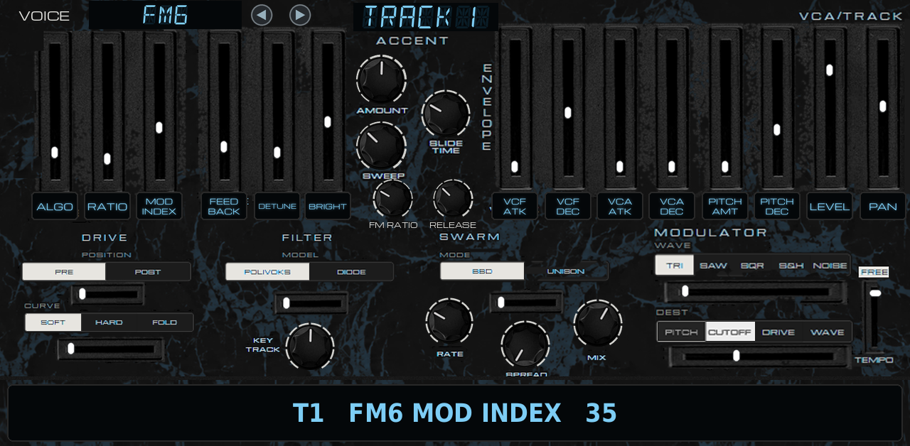
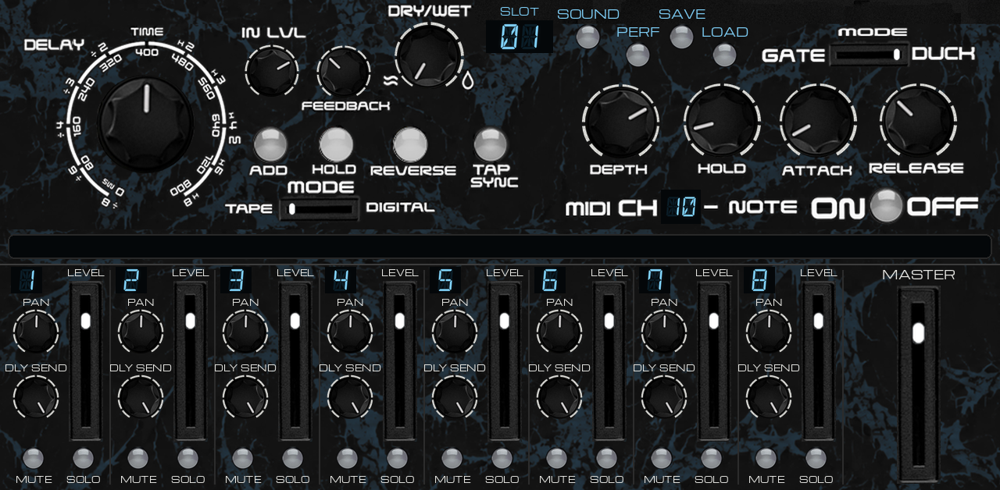

# LXRXXL ZYNTH v0.1.0





**An 8-track synth for the Akai Force and MPC (MPC OS 3.x, VST2 through
[mpc-vst-plugins](https://github.com/sd88me/mpc-vst-plugins)).**

LXRXXL ZYNTH is a variation of [LXRXXL BAZZLINE](https://github.com/sunskiefer/LXRXXL-BAZZLINE), itself a variation of
[LXRXXL](https://github.com/sunskiefer/LXR02XXL) (a port of the open-source Sonic Potions LXR engine inspired by the
Erica Synths LXR-02). It keeps everything of BAZZLINE: the LXR-02 style step sequencer with the DB-01's step functions,
the way it runs on the Force (MPC's grid and transport, the panel on the touchscreen, the project saved with MPC's),
the same knobs, the voice chain (FM, sub, noise, swarm, drive, Polivoks or diode filter, accent, slide), the delay,
the gate/duck, the mixer and the presets. What is new:

- **Sixteen voices, one per track:** each track picks its voice with the VOICE selector on the MODULES page. The six
  sliders on the left of MODULES become that voice's six most important controls, and their label windows show
  their names.
- **Each track remembers every voice's sliders:** switch FM6 to GRAIN and back, and the FM6 sound is as you left it.
- **LXRXXL's two randomizers** beside the panic key: SOUND RANDOM (green) and STEP RANDOM (yellow), with their
  amount knobs.
- **RELEASE** for the amp envelope and **FM RATIO** for FM LVL on every voice (MODULES).
- New artwork from Suns Kiefer's BAZZLINE panel: a vein texture and an ice-blue accent.

The voices were chosen after the custom firmwares of the M-VAVE FM-1 (Felucca, Sloop, Baud Girl), the Dirtywave M8
and LXRXXL's own voices. **No code from those firmwares or from the M8 is used** (the FM-1 firmwares are GPL-3, which
can't be combined with the LXR02 license, and the M8 is closed): the voices are written here, or come from Mutable
Instruments' MIT-licensed Braids and Plaits.

**Tested on an Akai Force** (MPC OS 3.9.1, see `tested.json`). Downloads: [Releases](https://github.com/sunskiefer/LXRXXL-ZYNTH/releases).
Every build is also tested offline (see [Testing](#testing)). Report anything odd under Issues.

## The three pages

MPC shows three tabs, each filling the whole screen: **PANEL**, **MODULES** and **FX MIXER**. PANEL and MODULES edit
the **selected track**: pick a track with TRACK 1-8 (PANEL) or TRACK (MODULES) and every knob and slider shows that
track's sound. FX MIXER has the delay, the gate/duck and a mixer of all eight tracks. Every knob turns in place.
MODULES and FX MIXER have a **readout** in big letters: the control you last touched, its track and its value
(`T3   CUTOFF   75`, `T1   FM6 MOD INDEX   35`, `DELAY TIME   400 ms`).

### PANEL (the front)

Everything is as on LXRXXL BAZZLINE, on every voice, plus the randomizers:

| Control | What it does |
|---|---|
| DRIVE | the overdrive, before or after the filter (MODULES: the POSITION and CURVE selectors) |
| DETUNE | the swarm's spread: BBD detune or unison (MODULES: SWARM). UNISON plays a second, detuned copy of the voice |
| VCA ENV | the amp envelope's decay. Fully down: the note is held while its gate is, then fades with RELEASE (MODULES) |
| VCF ENV / RESONANCE / CUTOFF | the filter envelope's amount, the resonance (self-oscillates at the top), the cutoff |
| SQR / SAW / TRI | BAZZ: its VCO's wave. Every other voice: the SUB oscillator's wave |
| BP / LP | the filter's band-pass or low-pass output |
| FM LVL / SUB LVL / NOISE LVL | FM on any voice (its ratio: MODULES' FM RATIO), the sub oscillator (an octave down), white noise |
| LFO RATE / LFO LVL | the modulator's rate and depth (wave, destination and sync: MODULES). Its WAVE destination moves the voice's main slider |
| ENV/CV LVL | the pitch envelope's amount (up to +4 octaves at the top) |
| SELECT/GATE, BACK/NOTE | the step encoders, as on BAZZLINE |
| DELAY: DRY/WET, TIME; RELEASE, GATE / DUCK | the delay's mix and time; the gate/duck's release and mode (as on FX MIXER) |
| The display | the tempo (its last dot lit: MPC's tempo), a value while you turn it, the function in use |
| TRACK 1-8, LINK, MUTE (SHIFT + MUTE = RESET) | as on BAZZLINE |
| **The panic key** (the ice button under the TRACK keys) | VOICE RESET: the selected track's sound back to the default, **its voice kept** (that voice's sliders at their defaults); its steps stay. **SHIFT + it = MUTE ALL**: every track muted and silenced at once (it stays lit); SHIFT + it again unmutes them all |
| **STEP RANDOM** (the yellow key, left of the panic key, with "?") | a new line on every track of the playing pattern: an euclidean rhythm per track, notes in the track's scale (a chromatic track gets a minor pentatonic) around its notes, accents and slides here and there. **SHIFT + it**: the selected track only. Its knob (the yellow one): the density, 0-100 % |
| **SOUND RANDOM** (the green key, right of the panic key, with the warning sign) | every track's sound moves by up to its knob's amount (the green one, 0-100 %): every knob and slider, and each selector changes with that chance. The voice, the level, the pan, the swarm's mode and the modulator's sync stay; the cutoff stays open enough to be heard. **SHIFT + it**: the selected track only |
| SHIFT, ▷, □, ○, ◄ BAR ►, -1 OCT / +1 OCT, TAP, the 16 step keys | as on BAZZLINE (SHIFT, then a step key: ACC, SLIDE, MOD, PITCH ENV, LAST STEP, PLAY MODE, TRANSP, SCALE, ARPEGG, LFO, RND PATT, CLEAR, COPY, PASTE, BANK, PATTERN) |

### MODULES (the voice and its modules)

| Section | Controls |
|---|---|
| **VOICE** (top left) | the selected track's voice: tap ◄ ►, or turn it with the data wheel or a Q-Link, or drag it. The display shows its name |
| **The six voice sliders** | the voice's six controls; their label windows show their names, and the readout their value (`T2   WHEEL   LESLIE   FAST 60`) |
| DRIVE | POSITION (PRE / POST the filter) and CURVE (SOFT / HARD / FOLD) |
| ACCENT | AMOUNT, SWEEP (accents in a row push the filter further), SLIDE TIME |
| **FM RATIO, RELEASE** (under SLIDE TIME) | FM LVL's ratio (1/4 .. 8) on any voice; the amp envelope's release (4 ms .. 4 s) |
| ENVELOPE | VCF ATK, VCF DEC, VCA ATK, VCA DEC (= VCA ENV), PITCH AMT (= ENV/CV LVL), PITCH DEC |
| VCA/TRACK | LEVEL, PAN |
| FILTER | MODEL (POLIVOKS 12 dB / DIODE ladder), KEY TRACK |
| SWARM | MODE (BBD / UNISON), RATE, SPREAD (= DETUNE), MIX |
| MODULATOR | WAVE (TRI SAW SQR S&H NOISE), DEST (PITCH CUTOFF DRIVE WAVE: the voice's main slider), FREE / TEMPO |
| TRACK | the selected track, at the top |

### FX MIXER (the effects and the mixer)

As on LXRXXL BAZZLINE: the delay (TIME, IN LVL, FEEDBACK, DRY/WET, ADD, HOLD, REVERSE, TAP SYNC, TAPE / DIGITAL), the
MIDI-triggered gate/duck, the mixer of the eight tracks (PAN, DLY SEND, LEVEL, MUTE, SOLO), MASTER and the presets.

## The voices

Each voice makes the raw tone of the track, which then goes through the same chain as LXRXXL BAZZLINE's voice:
FM LVL, SUB, NOISE, SWARM, DRIVE, FILTER, VCA. The tracks are monophonic, as on BAZZLINE (and the M8): the
sequencer's steps, the arpeggiator and slides play one note at a time per track.

| Voice | V1 | V2 | V3 | V4 | V5 | V6 | What it is |
|---|---|---|---|---|---|---|---|
| **ANALOG** | WAVE | PULSE WIDTH | DETUNE | INTERVAL | SYNC | MIX | Two polyBLEP oscillators: saw to square, pulse width, the second one detuned or at an interval, or hard-synced to the first (its ratio sweeps with SYNC). |
| **TRIO** | WAVE | OSC 2 INTERVAL | OSC 3 INTERVAL | DETUNE | LEVEL 2 | LEVEL 3 | Three oscillators, Minimoog style: saw to square, oscillators 2 and 3 at their own interval (-12..+12, -24..+24 semitones), a detune spread, their levels. |
| **FM6** | ALGO | RATIO | MOD INDEX | FEEDBACK | DETUNE | BRIGHT | Six sine operators on the DX7's 32 algorithms: RATIO picks one of 16 sets of operator ratios, MOD INDEX the modulators' level, FEEDBACK, DETUNE spreads the operators, BRIGHT how long the modulators stay up after the attack. |
| **FM4** | ALGO | RATIO B | RATIO C | MOD INDEX | FEEDBACK | DECAY | Four operators on 12 algorithms (op 4 with feedback): the ratios of op 2 (B) and op 3 (C), MOD INDEX, FEEDBACK, DECAY of the modulators. |
| **PHASE** | WAVE | AMOUNT | ENV AMOUNT | ENV DECAY | DETUNE | LINE 2 | Casio CZ style phase distortion: eight waves (SAW, SQUARE, PULSE, DOUBLE SINE, SAW PULSE, three resonance waves), AMOUNT, an envelope on the amount (ENV AMT, ENV DECAY), a detuned second line (DETUNE, LINE 2). |
| **WAVE** | BANK | POS X | POS Y | WARP TYPE | WARP AMOUNT | SCAN | Mutable Instruments Plaits' wavetable engine (4 banks of 8 x 8 waves): BANK, POS X, POS Y, a warp after it (FOLD, SHAPE, CRUSH, RING) and its amount, SCAN (an envelope that sweeps POS X). |
| **CHIP** | WAVE | BITS | RATE | ARP | SPEED | SWEEP | Console chips: pulses (12, 25, 50 %), the NES's 4-bit triangle, a stepped saw, LFSR noise (long and metallic); BITS, sample RATE, a fast chord ARP (octave, major, minor, 7ths, sus 4, power) at its SPEED, a pitch SWEEP up or down. |
| **MACRO** | SHAPE | TIMBRE | COLOR | TIMBRE ENV | COLOR ENV | ENV DECAY | Mutable Instruments Braids' macro oscillator: 44 shapes (Braids' list without its drums), TIMBRE and COLOR, each with an envelope (TIMBRE ENV, COLOR ENV, ENV DECAY). |
| **WHEEL** | BASS | BODY | BRIGHT | PERC | CLICK | LESLIE | A tonewheel organ: drawbars grouped as BASS (16' 5 1/3'), BODY (8' 4'), BRIGHT (2 2/3' .. 1'), PERC (2nd or 3rd harmonic, normal or fast), key CLICK, LESLIE (off, slow up to the middle, fast above, with its depth). |
| **VOICE** | VOWEL | FORMANT | BREATH | VIBRATO | RESO | TONE | A glottal pulse through three formants: VOWEL (A E I O U), FORMANT shift, BREATH, VIBRATO (it comes in after the attack), RESO (the formants' sharpness), TONE (the glottis's brightness). |
| **PHYS** | MODEL | STRUCTURE | BRIGHT | DAMPING | EXCITER | STRENGTH | Mutable Instruments Plaits' physical models: MODEL (a string, or a modal body of resonators), STRUCTURE, BRIGHT, DAMPING, EXCITER (strike, or bowed / blown above the bottom), STRENGTH. |
| **GRAIN** | SIZE | DENSITY | POSITION | SPRAY | PITCH SPREAD | TONE | A granular cloud of single-cycle waves: grain SIZE, DENSITY, POSITION through 16 waves, SPRAY (each grain's position drawn around it), PITCH SPREAD (octaves only at the top), TONE. |
| **NOISE** | TYPE | COLOR | RESO | HARMONICS | DENSITY | GRIT | TYPE (white, pink, crackle, digital, dust), COLOR (dark to bright), RESO (resonators tuned to the note), HARMONICS (the 2nd and 3rd), DENSITY (crackle, digital, dust), GRIT (bits and rate). |
| **LXR TONE** | WAVE | FM AMOUNT | FM FREQ | FM WAVE | FM ENV | DECIMATE | The LXR drum voice's oscillator, played on the keys: its WAVE, an FM modulator (FM AMT, FM FREQ, FM WAVE), FM ENV (the FM fading on each note), DECIMATE. |
| **LXR METAL** | CHARACTER | SPREAD | FM AMOUNT | NOISE | BAND | RING | The LXR's hi-hat and cymbal: six square oscillators at metallic ratios, played on the keys: CHARACTER (hats, cymbal, bell, gong), SPREAD, FM AMT, NOISE, BAND (a band-pass above the note), RING. |
| **BAZZ** | OSC MODE | WAVE POS | OCTAVE | SUB OCT | DRIFT | TONE | LXRXXL BAZZLINE's oscillator (VCO with the panel's SQR / SAW / TRI, FM, WAVE morph), with its range opened: WAVE POS, OCTAVE (-2..+2), SUB OCT (the sub one or two octaves down), DRIFT, TONE (BAZZLINE's tone filter). |

A stepped slider (ALGO, SHAPE, WAVE, MODEL...) picks its option along its travel: the display and the readout show
the option.

FM LVL works on every voice: the voice's tone goes through a short delay line swung by a sine at FM RATIO of the
note. Delaying a tone by `(I / 2πf)(1 - sin(2π r f t))` moves each of its harmonics by `k I sin(...)`: exactly a phase
modulation of the tone's own phase (index I, ratio r). BAZZ does it inside its oscillator, as BAZZLINE did.

## Automation and Q-Links

The knobs and sliders of PANEL and MODULES are the **selected track's** (as on BAZZLINE): MPC records automation on
the parameter (CUTOFF, VOICE CTRL 3...), and it plays back on the track that is selected. The six voice sliders are the
parameters VOICE CTRL 1-6: what they move is the voice's (V3 is MOD INDEX on FM6, POSITION on GRAIN). Pick the voice
before automating its sliders.

The Q-Link order is in **`qlinks.json`** (the Q-Link Map's format). Each Q-Link page is 8 knobs, one Force knob bank:

| Page | Q-Link page | Knobs 1-8 |
|---|---|---|
| PANEL | **PANEL 1** | STEP RND AMT, DRY/WET, DELAY TIME, SELECT/GATE, BACK/NOTE, RELEASE, GATE/DUCK, SOUND RND AMT |
| PANEL | **PANEL 2** | DRIVE, (empty), DETUNE, VCA ENV, FM LVL, SUB LVL, NOISE LVL, WAVE |
| PANEL | **PANEL 3** | VCF ENV, RESONANCE, CUTOFF, LFO RATE, LFO LVL, ENV/CV LVL, FILTER |
| MODULES | **MODULES 1** | the six voice sliders, DRIVE POS, CURVE |
| MODULES | **MODULES 2** | VCF ATK, VCF DEC, VCA ATK, VCA ENV, ENV/CV LVL, PITCH DEC, LEVEL, PAN |
| MODULES | **MODULES 3** | FILTER MODEL, KEY TRACK, ACCENT, SLIDE TIME, SWEEP, FM RATIO, TRACK, VOICE |
| MODULES | **MODULES 4** | SWARM MODE, SWARM RATE, DETUNE, SWARM MIX, MOD WAVE, MOD DEST, MOD SYNC, RELEASE (amp) |
| FX MIXER | **FX 1 - FX 5** | as on BAZZLINE: the delay; the gate/duck and MASTER; LEVEL 1-8; PAN 1-8; DLY SEND 1-8 |

### Presets: saving and loading

Four keys and a slot number on **FX MIXER**, top middle: **SLOT**, **SOUND**, **PERF**, **SAVE**, **LOAD**. The
big readout under them tells you what is happening at every step.

- **A SOUND** is one track's voice: its VOICE, every knob, slider and selector of PANEL and MODULES for that track,
  its LEVEL and PAN included, and the six sliders of every voice as that track left them (not its steps, not its DLY
  SEND, MUTE or SOLO). It is saved from, and loaded onto, the **selected track**.
- **A PERF** (performance) is everything: the eight sounds, the 64 patterns, the delay, the gate/duck, the mixer
  (levels, pans, sends, mutes, solos, master), the links and the tempo.
- **64 slots** of each. The slot number is the **SLOT** display: turn it with the data wheel or a Q-Link (it is
  on the FX Q-Link page), or drag it up or down.

**To save a sound:**
1. Select the track (TRACK 1-8 on PANEL, or TRACK on MODULES).
2. On FX MIXER, tap **SOUND** (it lights).
3. Pick a **SLOT**. The readout says `SOUND 05   EMPTY   (T1)`, or `SOUND 05   (T1)` when the slot is used (T1: the
   selected track).
4. Tap **SAVE**. The readout asks `SAVE T1 AS SOUND 05?  TAP SAVE AGAIN` (or `OVERWRITE SOUND 05 ...` when the slot
   is used) and SAVE blinks.
5. Tap **SAVE** again within 6 seconds: `SAVED T1 AS SOUND 05`. Anything else (another slot, SOUND/PERF, waiting)
   cancels.

**To load a sound:** select the track, tap **SOUND**, pick the **SLOT**, tap **LOAD**: `LOADED SOUND 05 ON T1`. It
loads at once, so you can step through the slots and tap LOAD on each to audition them. An empty slot says `EMPTY`
and changes nothing.

**To save a performance:** tap **PERF**, pick the **SLOT**, tap **SAVE**, then **SAVE** again (as for a sound).

**To load a performance:** tap **PERF**, pick the **SLOT**, tap **LOAD**: the readout warns
`LOAD PERF 05?  IT REPLACES EVERYTHING.  TAP LOAD AGAIN`; tap **LOAD** again. Save first anything you want to keep.

**Where the files are:** on the device, in `/sdcard/LXRXXL ZYNTH/` (outside the plugin's folder, so updating or
reinstalling the plugin keeps them):
- `Sounds/SOUND 01.zysound` .. `SOUND 64.zysound`: plain text, one `key=value` line per control;
- `Performances/PERF 01.zyperf` .. `PERF 64.zyperf`: the same text MPC's own project keeps for the instance.

You can copy, back up or share these files (over SSH, or with the SD card / drive in a computer) and drop them into
another device's folder: they appear in the slot their number says. Rename a file to move it to another slot. If
`/sdcard/LXRXXL ZYNTH` cannot be written, the plugin uses `LXRXXL ZYNTH Data` inside its own folder instead.

MPC's own project still saves and restores the whole instance as before: presets are for moving sounds and
performances between projects and devices.

### Playing it

### Playing it

- **MPC's play** plays the pattern on MPC's grid; **PLAY** on the panel plays it with MPC stopped.
- **Notes from the track** play the **selected track** (MIDI channel 1), or track 2-8 on channels 2-8. A note held
  over another slides to it. Velocity over 100 is an accent. With **REC** on, notes are written into the selected
  track.
- **The factory project:** one voice per track: 1 ACID (BAZZ), 2 E.PIANO (FM6), 3 PAD (WAVE), 4 PLUCK (PHYS),
  5 ORGAN (WHEEL), 6 CLOUD (GRAIN), 7 ARP (CHIP), 8 BELL (LXR METAL); six demo patterns: A1 everything together, A2
  the pad with plucks and the cloud, A3 the organ with the acid, A4 the plucks and the piano, A5 the chip and the
  bells, A6 the cloud and the pad.

## How the voices were made

The full map is in **[docs/VOICE_MAP.md](docs/VOICE_MAP.md)**. In short:

| Where from | Voices |
|---|---|
| Written here, for LXRXXL ZYNTH | ANALOG, TRIO, FM6 (operators; the DX7's algorithm table from Google's music-synthesizer-for-android, Apache 2.0), FM4, PHASE, CHIP, WHEEL, VOICE, GRAIN, NOISE |
| The LXR (LXR02Open's tables) | LXR TONE, LXR METAL, BAZZ (LXRXXL BAZZLINE's oscillator) |
| Mutable Instruments (MIT, `third_party/mutable`) | MACRO (Braids), WAVE (Plaits' wavetable engine), PHYS (Plaits' string and modal voices) |

## The licenses

LXRXXL ZYNTH, like LXRXXL and LXRXXL BAZZLINE, is under the **LXR02 Open-Source license** (`LICENSE`): **not for sale
or commercial use**, and every binary comes with its complete source (each release has a `-source.zip`). The parts
under `third_party/` keep their licenses: Braids, Plaits and stmlib (Emilie Gillet, Mutable Instruments) are MIT
(`third_party/mutable/LICENSE`), mpc-vst-plugins is MIT. The DX7 algorithm table in `src/eng_fm.c` is Apache 2.0
(Copyright 2012 Google Inc.). Artwork by Suns Kiefer: ask before reusing it. The fonts are SIL OFL 1.1.

*(This is a plain-language summary, not legal advice. The `LICENSE` files are what count.)*

## Installing

Needs root SSH access to the device (for example MockbaMod) and MPC OS 3.x. Unzip the release, then:

```
scp -r LXRXXL-ZYNTH-<version> root@<device-ip>:/tmp/
ssh -t root@<device-ip> sh /tmp/LXRXXL-ZYNTH-<version>/install.sh
```

The installer:
1. stops MPC (save first);
2. copies the plugin to `/sdcard/Synths/ANDREALPHEUS - VST - LXRXXL ZYNTH/`;
3. adds it to MPC's plugin list;
4. starts MPC again.

Load **LXRXXL ZYNTH** (ANDREALPHEUS) as a plugin instrument. `uninstall.sh` removes it. INSTALL.md in the zip has
the manual steps.

## Building

Python 3 with Pillow, numpy and scipy, a host gcc, clang and clang++, Zig (`pip install ziglang`); valgrind and
qemu-user for the tests. No Docker.

```
git clone https://github.com/sunskiefer/LXRXXL-ZYNTH
cd LXRXXL-ZYNTH
./build.sh             # build/arm/lxrxxl_zynth.so + the skin -> build/package/
test/run_tests.sh      # every voice on its own, the wrapper's host test, the engine tests and the MPC simulation (valgrind)
test/arm_sim.sh        # the MPC simulation built for ARM, run under qemu-arm
```

The tools:
- `tools/gen_params.py`: the parameter list. From now on parameters are only ever appended, because MPC stores
  automation by index.
- `tools/panel.py`: where every control of the artwork sits, and the Q-Link pages from `qlinks.json`. It writes `layout.conf`.
- `tools/zynth_art.py`: ZYNTH's artwork from BAZZLINE's (`art/bazzline/`): the vein texture (`art/texture/`), the ice
  accent, the ZYNTH logo (writes `art/panel/`).
- `tools/panel_art.py`: builds the three pages from the artwork (`art/panel/`), with the voice selector and the label
  windows (each voice's labels, read from `src/engines.c`).
- `tools/preview.py`: draws a page with chosen values.

## Testing

Offline, every build (`test/run_tests.sh`, and in CI):
- **Every voice on its own** (`test/eng_test.c`): each of the sixteen at its defaults plays in tune (its partials on
  the note), at a sensible level, with no NaN; 400 random settings and notes never blow up. Also built for ARM and
  run under qemu: the same results.
- **The framework's host test:** two instances, names, set/get, option stepping, notes into audio, the chunk.
- **The engine tests:** the six demo patterns play on MPC's transport; 20 000 random edits to every key and parameter;
  the state round-trip; every voice played by MIDI; VOICE, the six sliders and each voice's memory; VOICE < >; SOUND
  RANDOM and STEP RANDOM (all tracks and SHIFT: one); MIDI notes and the duck; the delay; the mixer; presets.
- **The MPC simulation** (through the VST2 wrapper only, also built for ARM and run under qemu): MPC's play and the
  panel's PLAY, the display, TRACK, the VOICE selector (its keys, the data wheel and a Q-Link), FM6 played, the
  readout, the encoders, SHIFT functions, the duck, the project saved and loaded, RESET.

On a device: 0.1.0 on an Akai Force, MPC OS 3.9.1 (`tested.json`).

Worst case offline (all eight tracks on the heaviest voices with UNISON, FM, sub and noise, plus the delay and the
duck): about 150 µs per 128-frame block on an x86 core (LXRXXL BAZZLINE's worst case was about 140 µs). The audio
runs with flush-to-zero on (denormals made the physical models five times slower). The device check
(`mpc-vst-plugins tools/bench.sh`, budget 2902 µs) is still to do.

## Credits and license

- **Developer:** L'Cronx.
- **Artwork by Suns Kiefer**
- **The LXR's oscillator tables:** Julian Schmidt (Sonic Potions LXR) and Brendan Clarke (LXR02Open), LXR02
  Open-Source license.
- **Braids, Plaits, stmlib:** Emilie Gillet (Mutable Instruments), MIT.
- **The DX7 algorithm table:** music-synthesizer-for-android, Copyright 2012 Google Inc., Apache 2.0.
- **The sequencer, the voice chain, the delay, the gate/duck, the mixer, the presets:** from LXRXXL BAZZLINE and LXRXXL.
- **VST2 wrapper, skin builder and installer:** sd88me, [mpc-vst-plugins](https://github.com/sd88me/mpc-vst-plugins) (MIT).
- **Fonts:** DSEG14 Classic by keshikan; Michroma by Vernon Adams (SIL Open Font License 1.1).

LXRXXL ZYNTH is not affiliated with or endorsed by Erica Synths, Sonic Potions, Mutable Instruments, M-VAVE, Dirtywave
or Akai Professional.
