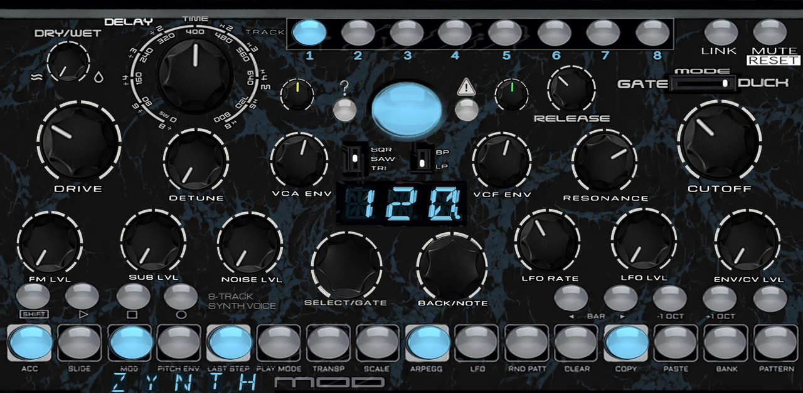
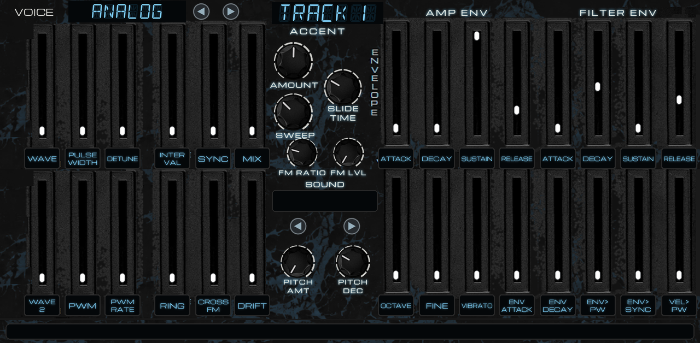
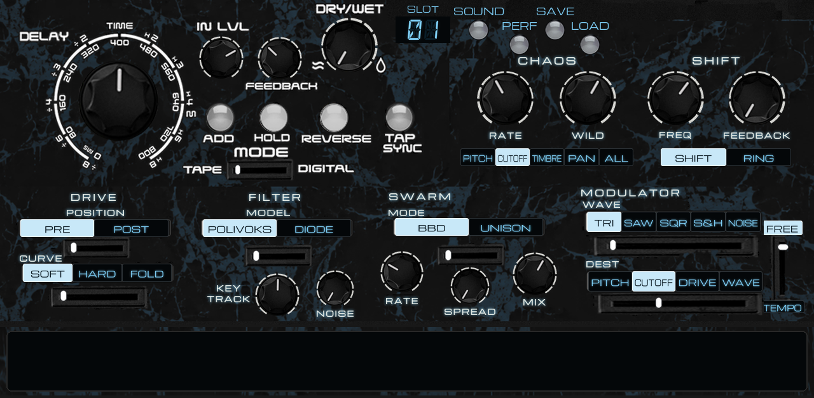
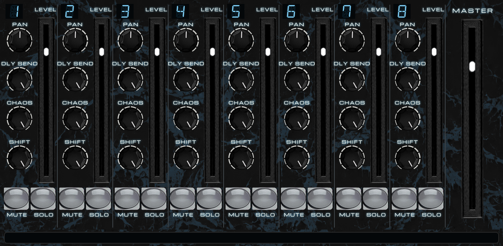

# LXRXXL ZYNTH: the user guide

**An experimental synth for Force and MPC: 19 coded voices on unconventional maths.** A Lorenz-attractor CHAOS,
a Hilbert-transform frequency SHIFTer, Euclidean rhythms and sine-wave melodies, and voices coded after the Yamaha
DX7, the Casio CZ, the Minimoog, Hammond tonewheels, NES and console chips, Mutable Instruments Braids and Plaits, the
LXR-02's drum voices and the Erica Synths DB-01 bass.

This guide covers everything: the pages, every control, the 19 voices and their 152 starter sounds, the sequencer,
the two randomizers, CHAOS and SHIFT, the mixer, presets, Q-Links and automation, and some recipes. The
[README](../README.md) has the short version, installing and building.

---

## Contents

1. [The idea in one minute](#1-the-idea-in-one-minute)
2. [First five minutes](#2-first-five-minutes)
3. [How a track makes sound](#3-how-a-track-makes-sound)
4. [The four pages](#4-the-four-pages)
   - [PANEL: the performance front](#41-panel-the-performance-front)
   - [VOICE: the voice and its envelopes](#42-voice-the-voice-and-its-envelopes)
   - [FX MOD: delay, CHAOS, SHIFT, drive, filter, swarm, modulator, presets](#43-fx-mod)
   - [MIXER](#44-mixer)
5. [The 19 voices](#5-the-19-voices)
6. [Starter sounds, home sounds and each voice's memory](#6-starter-sounds-home-sounds-and-each-voices-memory)
7. [The sequencer](#7-the-sequencer)
8. [STEP RANDOM: the melodic generator](#8-step-random-the-melodic-generator)
9. [SOUND RANDOM](#9-sound-random)
10. [CHAOS and SHIFT](#10-chaos-and-shift)
11. [Presets: sounds and performances](#11-presets-sounds-and-performances)
12. [Playing it from MPC: notes, tracks, automation, Q-Links](#12-playing-it-from-mpc)
13. [Recipes](#13-recipes)
14. [Every key combination](#14-every-key-combination)
15. [Questions and troubleshooting](#15-questions-and-troubleshooting)

---

## 1. The idea in one minute

- **Eight tracks**, each a monophonic synth with its own step sequence (up to 64 steps), like the LXR-02 or a
  DB-01, running in MPC's tempo and transport.
- **Each track picks a voice** (one of 19). The voice is the oscillator: an FM engine, a wavetable, a physical
  model, a granular cloud, an organ, a drone... Everything after it is shared: SUB, NOISE, FM, SWARM, DRIVE, the
  Polivoks or diode filter, the amp ADSR, the delay, CHAOS and SHIFT.
- **Each voice has 20 controls of its own** on the VOICE page, and **8 starter sounds**. Each track remembers every
  voice's whole sound: switch from FM6 to GRAIN and back and FM6 is as you left it.
- **The front page is for playing:** TIMBRE and MORPH (the voice's two most expressive controls), the filter, the
  ADSR, the modulator, CHAOS and SHIFT, the randomizers.
- **STEP RANDOM writes music** (chords, arpeggios, leads, bass lines, hits over a harmony the pattern keeps);
  **SOUND RANDOM** makes a new sound that suits the voice.

---

## 2. First five minutes

1. Load **LXRXXL ZYNTH** (L'Cronx) on a plugin track. The factory project is loaded: one voice per track.
2. Press **play** on MPC (or ▷ on the PANEL). Pattern A1 plays.
3. Tap **TRACK 1..8** on the PANEL to pick a track. Every knob now shows that track's sound.
4. Turn **TIMBRE** and **MORPH**: they are the voice's two most expressive controls (the readout names them).
5. Go to the **VOICE** tab. Tap **◄ ►** next to the voice's name to change voice. Tap **SOUND ◄ ►** (the middle
   column) to step through that voice's eight starter sounds.
6. Back on the PANEL, tap the yellow **STEP RANDOM** key (the "?" left of the big ice button): the selected track
   gets a new line that fits the pattern's harmony. Tap it on a few tracks: they play together.
7. Turn **CHAOS** (top right of the PANEL) up a little: every track starts to drift on its own. Turn **SHIFT** up:
   the tracks' frequency-shifted copies join in.
8. Save it: **FX MOD** tab, **PERF**, pick a **SLOT**, **SAVE**, **SAVE** again.

---

## 3. How a track makes sound

```
 VOICE (one of 19, its 20 controls)
   │  + UNISON: a second, detuned copy of the voice (SWARM MODE)
   ▼
 FM LVL × FM RATIO (phase modulation of any voice)
   ▼
 + SUB (an octave down, SQR / SAW / TRI)  + NOISE
   ▼
 SWARM (BBD detune)  →  DRIVE (PRE)  →  FILTER (Polivoks 12 dB or diode ladder, LP / BP)  →  DRIVE (POST)
   ▼
 VCA (the amp ADSR)  →  LEVEL, PAN  →  the mix
                                   ├─ DLY SEND  → the DELAY  ─┐
                                   ├─ SHIFT SEND → SHIFT ─────┼→ MASTER
                                   └─ (dry) ──────────────────┘
 CHAOS moves PITCH, CUTOFF, TIMBRE, PAN or ALL of every track, each from its own angle.
```

The modulators of a track: the **filter envelope** (ADSR, amount VCF ENV), the **amp envelope** (ADSR), the **pitch
envelope** (PITCH AMT, PITCH DEC), the **modulator** (an LFO: TRI SAW SQR S&H NOISE, to PITCH CUTOFF DRIVE or WAVE),
the voice's own **modulation envelope** (ENV ATTACK, ENV DECAY, to two of the voice's controls), **velocity** (to one
of the voice's controls), **accent** (ACCENT AMOUNT, SWEEP), **slide**, **vibrato**, and the shared **CHAOS**.

---

## 4. The four pages

MPC shows four tabs: **PANEL**, **VOICE**, **FX MOD**, **MIXER**. PANEL and VOICE (and FX MOD's DRIVE, FILTER,
SWARM and MODULATOR) edit the **selected track**. The delay, CHAOS and SHIFT are shared by all tracks. MIXER shows
all eight tracks at once.

A **readout** strip at the bottom of VOICE, FX MOD and MIXER shows the last control you touched, its track and its
value in words (`T3   CUTOFF   75`, `T1   FM6 MOD INDEX   35`, `SHIFT FREQ   +250 Hz`). The PANEL's three-character
display shows the tempo, or a value while you turn it.

### 4.1 PANEL: the performance front



| Control | What it does |
|---|---|
| **DELAY: DRY/WET, TIME** | the delay's mix and time (TIME's ring: musical divisions when the delay follows the beat) |
| **STEP RANDOM** (yellow key, "?") and its knob | a new line on the selected track; **SHIFT + it**: its setup ([§8](#8-step-random-the-melodic-generator)). The knob: the density |
| **The big ice key** | **VOICE RESET**: the selected track's voice back to its home sound. **SHIFT + it**: MUTE ALL (again: all back) |
| **SOUND RANDOM** (green key, warning sign) and its knob | a new sound for the selected track; **SHIFT + it**: every track ([§9](#9-sound-random)). The knob: how far |
| **CHAOS** | how much CHAOS moves every track ([§10](#10-chaos-and-shift)) |
| **SHIFT** | how loud the SHIFT bus comes back into the mix |
| **DRIVE** | the overdrive (before or after the filter: FX MOD) |
| **TIMBRE / MORPH** | the voice's two most expressive controls (they move the same faders as the VOICE page; table in [§5](#5-the-19-voices)) |
| **SUB: SQR / SAW / TRI** | the SUB oscillator's wave (BAZZ: its own oscillator's wave) |
| **BP / LP** | the filter's band-pass or low-pass |
| **VCF ENV / RESONANCE / CUTOFF** | the filter envelope's amount, the resonance (it sings near the top), the cutoff |
| **ATTACK / DECAY / SUSTAIN / RELEASE** | the amp ADSR. SUSTAIN at the top: the note holds while the key or step does. SUSTAIN at 0: it dies away over DECAY (plucks, keys) |
| **MOD RATE / MOD DEPTH** | the modulator's speed and amount (its wave and destination: FX MOD) |
| **SUB LVL** | the sub oscillator, an octave down |
| **SELECT/GATE, BACK/NOTE** | the step encoders: the selected step, and its note (it plays) |
| **The display** | the tempo (its last dot lit: MPC's tempo), a value while you turn it, the function in use |
| **TRACK 1-8, LINK, MUTE** | the selected track; LINK: this track plays the steps of the track before it; MUTE. **SHIFT + MUTE** = RESET (the factory project) |
| **SHIFT, ▷, □, ○** | SHIFT; play, stop, record (with MPC stopped the panel runs its own clock) |
| **◄ BAR ►, -1 OCT / +1 OCT, TAP** | the bar of a long pattern you see; the octave of the step keys' notes; tap tempo |
| **The 16 step keys** | toggle steps; with SHIFT: the 16 functions printed under them ([§7](#7-the-sequencer)) |

### 4.2 VOICE: the voice and its envelopes



**Top left: VOICE** (the display) with **◄ ►**: the selected track's voice. Tap the arrows, drag the display, turn the
data wheel or a Q-Link.

**The voice's 20 faders.** Each has a label window that names it; names and meanings change with the voice ([§5](#5-the-19-voices)).

| Where | Faders | What they are |
|---|---|---|
| Top row, left | **V1-V6** | the voice's main controls |
| Bottom row, left | **V7-V12** | the voice's deeper controls |
| Bottom row, right | **V13-V20** | the same eight kinds on every voice, aimed at the voice's own controls: **OCTAVE** (-2..+2), **FINE** (±1 semitone), **VIBRATO** (it comes in after the attack), **ENV ATTACK / ENV DECAY** (a modulation envelope), **ENV > a**, **ENV > b** (the envelope to two of the voice's controls, up or down from the centre), **VEL > c** (velocity to one control, up or down) |

**Top row, right: the envelopes, the same on every voice.**

| Faders | |
|---|---|
| **AMP ENV**: ATTACK, DECAY, SUSTAIN, RELEASE | the amp ADSR (the same as the PANEL's four knobs) |
| **FILTER ENV**: ATTACK, DECAY, SUSTAIN, RELEASE | the filter ADSR (its amount: the PANEL's VCF ENV) |

**The centre column.** ACCENT **AMOUNT**, **SWEEP** (accents in a row push the filter further), **SLIDE TIME**,
**FM RATIO** and **FM LVL** (FM on any voice), **SOUND ◄ ►** with the starter sound's name, **PITCH AMT** and
**PITCH DEC** (the pitch envelope: up to +4 octaves, falling into the note).

A stepped fader (ALGO, SHAPE, WAVE, MODEL, TYPE...) picks its option along its travel; the readout shows the option.

### 4.3 FX MOD



**The DELAY** (shared): TIME, IN LVL, FEEDBACK, DRY/WET, **ADD** (feed new sound into a held loop), **HOLD** (freeze
the loop), **REVERSE**, **TAP SYNC** (tap the time; off: TIME follows MPC's beat in divisions or free in ms),
**MODE** TAPE (the time bends the pitch, warm repeats) or DIGITAL (clean, crossfaded).

**The presets**: SLOT, SOUND, PERF, SAVE, LOAD ([§11](#11-presets-sounds-and-performances)).

**CHAOS** (shared): **RATE**, **WILD**, and **DEST** (PITCH, CUTOFF, TIMBRE, PAN, ALL) ([§10](#10-chaos-and-shift)).

**SHIFT** (shared): **FREQ** (the centre is 0; left: down, right: up, up to ±2 kHz), **FEEDBACK** (the barber pole),
**SHIFT / RING** ([§10](#10-chaos-and-shift)).

**For the selected track:**

| Section | Controls |
|---|---|
| **DRIVE** | POSITION (PRE / POST the filter), CURVE (SOFT / HARD / FOLD) |
| **FILTER** | MODEL (POLIVOKS 12 dB state-variable / DIODE ladder), KEY TRACK (the cutoff follows the note), **NOISE** (white noise into the filter) |
| **SWARM** | MODE (BBD: a bucket-brigade chorus of detuned copies / UNISON: a second, detuned copy of the voice), RATE, SPREAD (the detune), MIX |
| **MODULATOR** | WAVE (TRI SAW SQR S&H NOISE), DEST (PITCH CUTOFF DRIVE WAVE: WAVE moves the voice's main control), FREE / TEMPO (Hz, or note divisions of MPC's tempo); its RATE and DEPTH are on the PANEL |

### 4.4 MIXER



Eight strips and MASTER. Each strip: the track's number, **PAN**, **DLY SEND**, **CHAOS** (how much CHAOS moves this
track), **SHIFT** (how much of this track goes to the SHIFT bus), the **LEVEL** fader, **MUTE** and **SOLO**. Any
track, not only the selected one.

---

## 5. The 19 voices

Each voice is coded here (or comes from Mutable Instruments' open-source code), *after* the instruments named: no
code or sounds were copied from the machines themselves. The tracks are monophonic.

**TIMBRE / MORPH** are the PANEL's two knobs for that voice. **V13-V20** are the same on every voice (OCTAVE, FINE,
VIBRATO, ENV ATTACK, ENV DECAY, ENV > a, ENV > b, VEL > c); the "targets" column says what a, b and c are.

| Voice | After | V1-V6 (main) | V7-V12 (deeper) | TIMBRE / MORPH | ENV > a, b; VEL > c |
|---|---|---|---|---|---|
| **ANALOG** | a two-oscillator analogue | WAVE, PULSE WIDTH, DETUNE, INTERVAL, SYNC, MIX | WAVE 2, PWM, PWM RATE, RING, CROSS FM, DRIFT | PULSE WIDTH / SYNC | PW, SYNC; PW |
| **TRIO** | the Minimoog's three oscillators | WAVE, OSC 2 INTERVAL, OSC 3 INTERVAL, DETUNE, LEVEL 2, LEVEL 3 | WAVE 2, WAVE 3, OSC 3 TO PITCH, OSC 3 LOW, FEEDBACK, DRIFT | DETUNE / LEVEL 2 | DETUNE, LEVEL 3; WAVE |
| **FM6** | the Yamaha DX7 (its 32 algorithms) | ALGO, RATIO, MOD INDEX, FEEDBACK, DETUNE, BRIGHT | MOD ATTACK, DECAY TILT, INHARMONIC, OP 6 FIXED, CARRIER SPREAD, KEY SCALE | MOD INDEX / FEEDBACK | INDEX, FEEDBACK; INDEX |
| **FM4** | four-operator FM (12 algorithms) | ALGO, RATIO B, RATIO C, MOD INDEX, FEEDBACK, DECAY | RATIO D, MOD ATTACK, OP 4 FIXED, INHARMONIC, CARRIER SPREAD, KEY SCALE | MOD INDEX / FEEDBACK | INDEX, FEEDBACK; INDEX |
| **PHASE** | the Casio CZ's phase distortion | WAVE, AMOUNT, ENV AMOUNT, ENV DECAY, DETUNE, LINE 2 | WAVE 2, DCW ATTACK, DCW SUSTAIN, LINE 2 OCTAVE, RING, NOISE MOD | AMOUNT / ENV AMOUNT | AMOUNT, ENV AMOUNT; AMOUNT |
| **WAVE** | Mutable Instruments Plaits' wavetables | BANK, POS X, POS Y, WARP TYPE, WARP AMOUNT, SCAN | SCAN DECAY, SCAN Y, DRIFT, RING RATIO, WARP ENV, BRIGHT | POS X / WARP AMOUNT | POS X, POS Y; POS X |
| **CHIP** | NES and console sound chips | WAVE, BITS, RATE, ARP, SPEED, SWEEP | PULSE MOD, ARP OCTAVES, ARP MODE, NOISE MIX, DUAL, BLIP | BITS / SWEEP | BITS, RATE; BITS |
| **MACRO** | Mutable Instruments Braids (44 shapes) | SHAPE, TIMBRE, COLOR, TIMBRE ENV, COLOR ENV, ENV DECAY | SHAPE ATTACK, CRUSH, DOWNSAMPLE, DRIFT, SIGNATURE, BRIGHT | TIMBRE / COLOR | TIMBRE, COLOR; TIMBRE |
| **WHEEL** | the Hammond tonewheel organ | BASS, BODY, BRIGHT, PERC, CLICK, LESLIE | 5 1/3', 2 2/3', 1 3/5', 1', SCANNER VIBRATO, LEAKAGE | BRIGHT / LESLIE | BRIGHT, BODY; CLICK |
| **VOICE** | a formant singer | VOWEL, FORMANT, BREATH, VIBRATO, RESO, TONE | SINGER FORMANT, NASAL, GLOTTAL PULSE, CHOIR, JITTER, BREATH ATTACK | VOWEL / FORMANT | VOWEL, FORMANT; BREATH |
| **PHYS** | Plaits' string and modal models | MODEL, STRUCTURE, BRIGHT, DAMPING, EXCITER, STRENGTH | BODY, STRIKE NOISE, PITCH STRIKE, MUTE, SYMPATHETIC, DRIVE | STRUCTURE / BRIGHT | STRUCTURE, BRIGHT; BRIGHT |
| **GRAIN** | a granular cloud | SIZE, DENSITY, POSITION, SPRAY, PITCH SPREAD, TONE | REVERSE, WINDOW, SCAN SPEED, DETUNE, OCTAVE UP, JITTER | DENSITY / POSITION | POSITION, DENSITY; SIZE |
| **NOISE** | noise sources and resonators | TYPE, COLOR, RESO, HARMONICS, DENSITY, GRIT | SWEEP, PULSE, PULSE RATE, TONE, INHARMONIC, LOW CUT | COLOR / RESO | COLOR, RESO; COLOR |
| **LXR TONE** | the LXR-02's drum oscillator, played as a synth | WAVE, FM AMOUNT, FM FREQ, FM WAVE, FM ENV, DECIMATE | PITCH ENV, PITCH DECAY, CLICK, SINE BODY, SYNC, FOLD | FM AMOUNT / FOLD | FM AMOUNT, FOLD; FM AMOUNT |
| **LXR METAL** | the LXR-02's hats and cymbals, tuned | CHARACTER, SPREAD, FM AMOUNT, NOISE, BAND, RING | DETUNE, TONE, BAND Q, LOW CUT, SHIMMER, CRUSH | SPREAD / FM AMOUNT | SPREAD, BAND; FM AMOUNT |
| **BAZZ** | the Erica Synths DB-01 bass, via LXRXXL BAZZLINE | OSC MODE, WAVE POS, OCTAVE, SUB OCT, DRIFT, TONE | OSC 2 LEVEL, OSC 2 DETUNE, OSC 2 OCTAVE, FOLD, CRUSH, SATURATE | WAVE POS / TONE | WAVE POS, TONE; TONE |
| **DRONE** | BAZZ's oscillator grown into a stack | WAVE, VOICES (2-7), DETUNE, STACK, DRIFT, MOTION | MOTION RATE, BEAT, SUB, SHIMMER, BLOOM, TONE | WAVE / DETUNE | WAVE, DETUNE; TONE |
| **TEXTURE** | the LXR's noise and metal, as beds | SOURCE, DENSITY, PITCH TRACK, COLOR, RESO, MOTION | MOTION RATE, GRIT, WIND, SPARKLE, RUMBLE, SPACE | SOURCE / COLOR | COLOR, RESO; COLOR |
| **FX** | the LXR voice restructured for effects | TYPE, SWEEP TIME, SWEEP DEPTH, REPEAT, CHAOS, WOBBLE | WOBBLE RATE, CRUSH, NOISE, RING, FEEDBACK, TONE | SWEEP DEPTH / WOBBLE | SWEEP DEPTH, CHAOS; SWEEP DEPTH |

Notes on some voices:

- **FM6:** ALGO picks one of the DX7's 32 algorithms; RATIO one of 16 sets of operator ratios. MOD INDEX is the
  modulators' level, BRIGHT how long they stay up after the attack, DECAY TILT makes the higher operators shorter
  (or longer), INHARMONIC detunes the ratios off whole numbers (bells), OP 6 FIXED fixes operator 6's pitch (clangs),
  KEY SCALE makes high notes less bright.
- **PHASE:** eight waves (SAW, SQUARE, PULSE, DOUBLE SINE, SAW PULSE and three resonance waves); the DCW envelope
  (ATTACK, DECAY, SUSTAIN) opens the distortion; LINE 2 adds a second, detuned line.
- **CHIP:** WAVE: PULSE 12 / 25 / 50 %, TRIANGLE (the NES's stepped one), SAW, NOISE, METAL NOISE. ARP: a fast chord
  arpeggio (OCTAVE, MAJOR, MINOR, MAJ 7, MIN 7, SUS 4, POWER), ARP MODE UP / DOWN / UP DOWN / RANDOM.
- **WHEEL:** BASS, BODY and BRIGHT are drawbar groups; V7-V10 are the single drawbars 5 1/3', 2 2/3', 1 3/5', 1'.
  LESLIE: off at the bottom, slow up to the middle, fast above.
- **DRONE:** STACK: UNISON, OCTAVES, FIFTHS, OCT + 5TH, MINOR, MAJOR, SUS, CLUSTER. BLOOM fades the upper voices
  in. It holds for as long as the note does.
- **TEXTURE:** SOURCE moves from noise through metallic partials to dust; PITCH TRACK tunes its resonators to the note.
- **FX:** TYPE: LASER, ZAP, RISER, FALL, SIREN, ALARM, GLITCH, BOMB. SWEEP TIME and SWEEP DEPTH shape the sweep,
  REPEAT retriggers it, CHAOS scrambles it, WOBBLE (and its RATE) bends it.
- **BAZZ:** OSC MODE VCO (with the PANEL's SQR / SAW / TRI), FM or WAVE (a morph), the original BAZZLINE bass.

**FM LVL** works on every voice: the voice's sound goes through a short delay line swung by a sine at FM RATIO times
the note. Delaying a tone by `(I / 2πf)(1 - sin(2π r f t))` moves each of its harmonics by `k·I·sin(...)`, which is
exactly a phase modulation of the tone's own phase (index I, ratio r).

---

## 6. Starter sounds, home sounds and each voice's memory

- **Each voice has 8 starter sounds**, picked with **SOUND ◄ ►** on the VOICE page (its name shows between the
  keys). The first one is the voice's **home sound**: the chain set so the voice sounds as itself (held voices held,
  plucked and struck ones ringing, BAZZ as the BAZZLINE bass).
- **Each track remembers every voice's whole sound:** its 20 controls and the chain (filter, envelopes, drive, FM,
  swarm, modulator...). LEVEL and PAN stay the track's whatever the voice.
- **VOICE RESET** (the big ice key) brings the voice in use back to its home sound. The other voices' sounds are kept.

| Voice | The eight starter sounds |
|---|---|
| ANALOG | ANALOG, SAW LEAD, SQUARE BASS, SYNC LEAD, PWM STRINGS, FIFTH STAB, BRASS, CROSS BELL |
| TRIO | TRIO, FAT BASS, MOOG LEAD, TRILL LEAD, WIDE PAD, OCTAVE STACK, GROWL, DRIFT CHOIR |
| FM6 | FM6, E.PIANO, BELL, FM BASS, BRASS, ORGAN, MARIMBA, FB GROWL |
| FM4 | FM4, DX BASS, CHIME, WOOD, FM LEAD, FM PAD, PLUCK, METAL |
| PHASE | PHASE, CZ BASS, RESO LEAD, CZ STRINGS, CZ BRASS, RESO BELL, PULSE KEYS, NOISE SYNTH |
| WAVE | WAVE, SCAN PAD, DIGI BELL, CRUSH LEAD, RING BELL, SHAPE BASS, WARP SWEEP, DRIFT KEYS |
| CHIP | CHIP, NES LEAD, NES BASS, MAJOR ARP, MINOR ARP, BLIP, NOISE HIT, DUAL PULSE |
| MACRO | MACRO, SAW SWARM, PLUCKED, BOWED, VOWEL, FM BELL, WAVE CHORD, SQUARE SUB |
| WHEEL | WHEEL, JAZZ, GOSPEL, ROCK, THEATRE, FLUTE, PERC ORGAN, REED |
| VOICE | VOICE, CHOIR AH, OOH PAD, SINGER, WHISPER, ROBOT, NASAL, VOWEL SWEEP |
| PHYS | PHYS, NYLON, STEEL, MARIMBA, PHYS BELL, BOWED, KALIMBA, SITAR |
| GRAIN | GRAIN, CLOUD, SHIMMER, SCAN, REVERSE, BUZZ, GRAIN KEYS, FROZEN |
| NOISE | NOISE, WIND, OCEAN, VINYL, TUNED NOISE, STEAM, GEIGER, CRACKLE |
| LXR TONE | LXR TONE, SINE BASS, FM KEYS, SYNC LEAD, FOLD BASS, LXR TOM, CLICK KEYS, BITS LEAD |
| LXR METAL | LXR METAL, BELLS, GONG, SHIMMER PAD, HATS, CYMBAL, METAL BASS, CRUSHED |
| BAZZ | BAZZLINE, ACID, DB-01 SUB, FM BASS, WAVE BASS, DOUBLE, FOLD BASS, REESE |
| DRONE | DRONE, DARK DRONE, FIFTHS, MINOR CLOUD, BEATING, SHIMMER, CLUSTER, SAW WALL |
| TEXTURE | TEXTURE, RAIN, WIND, MACHINE, SPARKLES, UNDERWATER, TUNED BED, STATIC |
| FX | LASER, ZAP, RISER, FALL, SIREN, ALARM, GLITCH, BOMB |

Picking a starter sound replaces that voice's sound on the track (save it first as a SOUND preset if you want to
keep it).

---

## 7. The sequencer

As on LXRXXL BAZZLINE (the DB-01's step functions):

- **64 patterns** (4 banks of 16), each with eight tracks of up to **64 steps**. A step has a note, a **velocity**,
  and flags: ACCENT, SLIDE, MOD (the modulator on this step), PITCH ENV.
- **Step keys** toggle steps; **◄ BAR ►** shows the other bars of a long pattern. **SELECT/GATE** picks a step,
  **BACK/NOTE** sets its note (it plays).
- **SHIFT, then a step key:**

| Key | Function |
|---|---|
| 1 ACC, 2 SLIDE, 3 MOD, 4 PITCH ENV | the step keys toggle that flag on the steps |
| 5 LAST STEP | the next step key you press is the track's last step (its length) |
| 6 PLAY MODE | step keys 1-4 pick FORWARD, REVERSE, PING-PONG, RANDOM |
| 7 TRANSP | the step keys transpose the track (0..+12), BACK/NOTE -24..+24 |
| 8 SCALE | the step keys pick the track's scale (CHR MAJ MIN DOR PHR LYD MIX LOC HMN PMJ PMN BLU) |
| 9 ARPEGG | step keys 1-5 pick the arpeggiator: OFF, UP, DOWN, UP-DOWN, RANDOM (root, 3rd, 5th, octave of the scale) |
| 10 LFO | the step keys pick the modulator's wave (1-5), destination (9-12) and FREE / TEMPO (16) |
| 11 RND PATT | STEP RANDOM on the selected track |
| 12 CLEAR | clears the track's steps (and their velocities) |
| 13 COPY, 14 PASTE | copy the track's steps (with velocities) and paste them onto another track or pattern |
| 15 BANK, 16 PATTERN | pick a bank, then a pattern (queued to the end of the playing one) |

- **SHIFT** again (or any function's key) leaves a function.
- **REC** on: notes played into the track are written at the nearest step, with their velocity (112 or more: an
  accent). With MPC stopped they are entered step by step from the selected step.
- **Velocity:** a step's velocity sets how loud and how bright it plays (and drives VEL > on the voice). Steps you
  toggle by hand have the default velocity (100, accented 127).

---

## 8. STEP RANDOM: the melodic generator

The yellow key writes a new line on the **selected track** of the playing pattern. Its knob is the **density**
(10-100 %: from a few notes to every step). Each press draws new numbers, so pressing again gives a new line.

### The harmony

Each pattern keeps a **harmony** that every track generated in it plays over, so tracks generated one at a time fit
together:

- a **key**: a root (C..B) and a mode (MAJOR, MINOR, DORIAN, PHRYGIAN, LYDIAN, MIXOLYDIAN, HARMONIC MINOR);
- a **progression** of four chords over the pattern, one of 24 (I-V-VI-IV, VI-IV-I-V, II-V-I-I, I-VI-III-VII...);
- a **chord colour**: triads, sevenths, sus 2, sus 4 or add 9.

That is 12 × 7 × 24 × 5 = **10 080 harmonies**. The first STEP RANDOM in a pattern picks one. A track whose SCALE is
set keeps its own scale (from C).

### What a track plays: its style

By default (**AUTO**) a track's style follows its voice; you can set it in the setup.

| Style | Voices (AUTO) | The maths |
|---|---|---|
| **BASS** | BAZZ | the chords' roots on a Euclidean rhythm (k notes spread evenly over n steps, rotated), with fifths, octaves, approach notes into the next chord, slides and off-beat accents |
| **CHORD** | WAVE, WHEEL, GRAIN, TRIO, VOICE, DRONE, TEXTURE | one tone of each chord per track (the first CHORD track the root, the next the third, then the fifth...: CHORD tracks build the chords together), moved to the octave nearest the last note (voice leading). Low density: held through the chord; middle: Euclidean stabs; high: pulses |
| **ARP** | CHIP, FM4, MACRO, PHASE | the chord's tones over one to three octaves in the order idx(i) = (a·i + b) mod m, with a coprime to m: up, down and every leap-frog order in between, a new order per chord |
| **LEAD** | ANALOG, FM6, PHYS, LXR TONE | a melody from two sine waves, y(i) = A1·sin(2πi/P1 + φ1) + A2·sin(2πi/P2 + φ2), read as scale degrees, landing on a chord tone on every beat, with breaths between phrases and slides between near notes |
| **HITS** | LXR METAL, NOISE, FX | sparse Euclidean hits on the high chord tones |

### Velocities

Every step it writes has a velocity, by the track's velocity mode: **FLAT** (all 100), **GROOVE** (the beats strong,
the off-beats soft: the default), **HUMAN** (around 100, loose), **SWELL** (rising through each chord). 112 or more
is an accent.

### The setup: SHIFT + STEP RANDOM

The yellow key blinks, the display says `SET`, and the readout shows the track's settings and the harmony
(`T1   16 STEPS   GROOVE   AUTO LEAD   C MINOR   I-VI-III-VII   SEVENTHS`). In the setup:

| Key | Sets |
|---|---|
| Steps **1-8** (ACC .. SCALE) | the length it writes: **4, 8, 12, 16, 24, 32, 48, 64** steps (lit: the one set) |
| Steps **9-12** (ARPEGG .. CLEAR) | the velocities: **FLAT, GROOVE, HUMAN, SWELL** (lit: the one set) |
| Step **13** (COPY) | the style, round: AUTO, CHORD, ARP, LEAD, BASS, HITS (lit when not AUTO) |
| Step **14** (PASTE) | the key's root a semitone up |
| Step **15** (BANK) | the next mode |
| Step **16** (PATTERN) | a new progression and chord colour (the key kept) |
| **BACK/NOTE** / **SELECT/GATE** | the root / the mode |
| **STEP RANDOM** | a new line on **every track** of the pattern, then back to the steps |
| **SHIFT** | back to the steps |

The length, velocities and style are each track's own; the harmony is the pattern's.

---

## 9. SOUND RANDOM

The green key makes a new sound for the **selected track** (**SHIFT + it**: every track, each with its own draw),
true to its voice. Its knob is how far it goes (0-100 %).

- **A character for the voice's family**, moved towards by the knob's amount, with a little random on top:
  sustained voices go for PAD, LEAD, PLUCK or KEYS; struck voices (PHYS, LXR TONE, LXR METAL) for RING, BLIP or
  BELL; BAZZ for ACID, SUB or PUNCH; any voice now and then for HOME (more often at a low amount). The readout names
  it (`T1   SOUND RANDOM   50 %   PAD`).
- **The voice's own controls** (all 20 but OCTAVE and FINE, so the tracks stay in tune) move by up to the amount;
  a stepped control (an algorithm, a wave, a model) changes option with a chance of 0.7 × the amount.
- **The harsh ones stay tame at low amounts:** DRIVE, RESONANCE, the pitch envelope, FM, NOISE and SUB have a
  ceiling that opens with the square of the amount; the cutoff stays open enough to be heard.
- The voice, LEVEL, PAN, the swarm's mode and the modulator's sync never change. A value never lands where it was,
  nor back where it was before the last press.

---

## 10. CHAOS and SHIFT

Two shared effects that make the synth sound like it comes from somewhere else.

### CHAOS: a modulator that never repeats

A **Lorenz attractor**, the "butterfly" of chaos theory:

```
dx/dt = 10 (y - x)      dy/dt = x (28 - z) - y      dz/dt = x·y - (8/3)·z
```

It never settles and never repeats. Each track reads it **from its own angle** (a different mix of x, y and z), so the
eight tracks drift apart like living things rather than wobbling together like an LFO.

| Control | Where | |
|---|---|---|
| **CHAOS** | PANEL | how much, overall (0: off) |
| **RATE** | FX MOD | how fast the attractor runs |
| **WILD** | FX MOD | from a calm, almost regular orbit (left) to full chaos (right) |
| **DEST** | FX MOD | **PITCH** (±7 semitones at full), **CUTOFF** (±3 octaves), **TIMBRE** (the voice's main control), **PAN**, **ALL** (a little of each) |
| **CHAOS** per track | MIXER | how much this track takes (all at full by default) |

### SHIFT: a frequency shifter and ring modulator

A send bus: each track sends to it with its **SHIFT** knob on the MIXER, and the PANEL's **SHIFT** knob brings it
back into the mix.

- **SHIFT** mode is a true **frequency shifter**: a Hilbert transformer makes the signal's 90-degree twin, and the
  pair is multiplied with a quadrature oscillator. **Every partial moves by the same number of Hz.** A harmonic sound
  turns inharmonic: bells turn into alien metal, voices into radio transmissions, chords into something unearthly.
- **RING** mode multiplies the sound with a sine: the metallic, robotic sum-and-difference tones.
- **FREQ:** the centre is 0 Hz, left shifts down, right shifts up, from fractions of a Hz near the centre up to about
  2 kHz at the ends. The readout shows the Hz.
- **FEEDBACK** sends the shifted sound back in. With a small FREQ it becomes the **barber pole**: an endless rise (or
  fall) that never arrives.

---

## 11. Presets: sounds and performances

On **FX MOD**, top middle: **SLOT**, **SOUND**, **PERF**, **SAVE**, **LOAD**. The readout tells you what happens.

- **A SOUND** is one track's sound: its voice and every voice's whole sound as the track left it, with LEVEL and
  PAN (not its steps or sends). It is saved from, and loaded onto, the **selected track**.
- **A PERF** (performance) is everything: the eight sounds, the 64 patterns with their velocities and harmonies, the
  delay, CHAOS and SHIFT, the mixer, the links and the tempo.
- **64 slots** of each. Turn SLOT with the data wheel or a Q-Link, or drag it.

**Save:** SOUND (or PERF), pick a SLOT, **SAVE** (it asks; SAVE blinks), **SAVE** again within 6 seconds.
**Load a sound:** SOUND, SLOT, **LOAD** (at once: step through the slots and LOAD each to audition).
**Load a performance:** PERF, SLOT, **LOAD**, then **LOAD** again (it replaces everything).

The files live in `/sdcard/LXRXXL ZYNTH/` (`Sounds/SOUND nn.zysound`, `Performances/PERF nn.zyperf`), outside the
plugin's folder, so reinstalling keeps them. Copy and share them freely. 0.1.0's sounds and performances load as
they were.

MPC's own project also saves and restores the whole instance.

---

## 12. Playing it from MPC

- **MPC's play** runs the patterns on MPC's grid; **▷** on the PANEL plays with MPC stopped.
- **Notes** on MIDI channel 1 play the **selected track**; channels 2-8 play tracks 2-8. A note held over another
  slides to it. Velocity is used.
- **Automation:** the knobs and faders of PANEL, VOICE and FX MOD's sections are the **selected track's**: MPC records
  the parameter (CUTOFF, VOICE CTRL 3...) and plays it back on the selected track. VOICE CTRL 1-20 mean what the voice
  says (V3 is MOD INDEX on FM6, POSITION on GRAIN): pick the voice first. TIMBRE and MORPH follow the voice.
- **Q-Links** (`qlinks.json`), each page one bank of the Force's eight knobs:

| Page | Q-Link page | Knobs |
|---|---|---|
| PANEL | PANEL 1 | STEP RND AMT, DRY/WET, DELAY TIME, SELECT/GATE, BACK/NOTE, CHAOS, SHIFT MIX, SOUND RND AMT |
| PANEL | PANEL 2 | DRIVE, TIMBRE, MORPH, VCF ENV, RESONANCE, CUTOFF, FILTER, WAVE |
| PANEL | PANEL 3 | ATTACK, DECAY, SUSTAIN, RELEASE, MOD RATE, MOD DEPTH, SUB LVL |
| VOICE | VOICE 1 | V1-V6, VOICE, TRACK |
| VOICE | VOICE 2 | V7-V12, PITCH AMT, PITCH DEC |
| VOICE | VOICE 3 | V13-V20 |
| VOICE | VOICE 4 | the amp ADSR, the filter ADSR |
| VOICE | VOICE 5 | ACCENT, SWEEP, SLIDE TIME, FM RATIO, FM LVL |
| FX MOD | FX MOD 1 | DELAY TIME, IN LVL, FEEDBACK, DRY/WET, DELAY MODE |
| FX MOD | FX MOD 2 | CHAOS RATE, CHAOS WILD, CHAOS DEST, SHIFT FREQ, SHIFT FEEDBACK, SHIFT MODE, PRESET SLOT |
| FX MOD | FX MOD 3 | DRIVE POS, CURVE, FILTER MODEL, KEY TRACK, NOISE LVL |
| FX MOD | FX MOD 4 | SWARM MODE, SWARM RATE, DETUNE, SWARM MIX, MOD WAVE, MOD DEST, MOD SYNC |
| MIXER | MIXER 1-5 | LEVEL 1-8; PAN 1-8; DLY SEND 1-8; CHAOS 1-8; SHIFT SEND 1-8 |
| MIXER | MIXER 6 | MASTER |

---

## 13. Recipes

**Alien choir.** Track on VOICE, starter **CHOIR AH**. CHAOS DEST **PITCH**, RATE low, WILD at the middle, the
PANEL's CHAOS a quarter up. On the MIXER, SHIFT for this track up. SHIFT mode **SHIFT**, FREQ just right of the
centre (+3..+10 Hz), SHIFT MIX half up.

**Radio voice.** VOICE, **SINGER** or **ROBOT**. Filter **BP**, CUTOFF at the middle, RESONANCE a third. SHIFT
**RING**, FREQ around +600 Hz, the track's SHIFT send up, SHIFT MIX half. A little DRIVE (POST, HARD).

**Barber-pole drone.** DRONE, **FIFTHS** or **MINOR CLOUD**, a long note (SUSTAIN up, a slid step). SHIFT mode
**SHIFT**, FREQ +0.5..+2 Hz, FEEDBACK three quarters, SHIFT MIX up: it rises forever. Left of the centre: it falls.

**Living pad.** WAVE **SCAN PAD** or GRAIN **CLOUD**. CHAOS DEST **TIMBRE**, WILD full, RATE low: the timbre wanders
and never repeats. Several pad tracks each wander their own way.

**Chaos acid.** BAZZ **ACID**, STEP RANDOM with the style BASS and GROOVE velocities. CHAOS DEST **CUTOFF**, WILD
high, RATE medium, CHAOS a third up: the filter moves like a hand that never does the same thing twice.

**Metal rain.** LXR METAL **BELLS** on HITS, TEXTURE **RAIN** under it. SHIFT **RING** at a few hundred Hz on the
bells only (MIXER: their SHIFT up, the others down).

**A generated track in four presses.** SHIFT + STEP RANDOM (the setup); step 4 (16 steps), step 10 (GROOVE); STEP
RANDOM: every track gets a part over the pattern's harmony. Then on each track SOUND RANDOM at 30 %.

---

## 14. Every key combination

| Keys | Does |
|---|---|
| TRACK 1-8 | select a track |
| SHIFT + MUTE | RESET: the factory project |
| Ice key | VOICE RESET (the voice's home sound) |
| SHIFT + ice key | MUTE ALL / all back |
| STEP RANDOM | a new line on the selected track |
| SHIFT + STEP RANDOM | its setup (then STEP RANDOM: every track) |
| SOUND RANDOM | a new sound on the selected track |
| SHIFT + SOUND RANDOM | a new sound on every track |
| SHIFT + step 1-16 | the step functions ([§7](#7-the-sequencer)) |
| In the STEP RANDOM setup: steps 1-8 / 9-12 / 13 / 14 / 15 / 16 | length / velocities / style / root up / mode / new progression |
| VOICE ◄ ► | the selected track's voice |
| SOUND ◄ ► | the voice's starter sounds |
| SOUND / PERF, SAVE twice | save a sound / a performance |
| SOUND, LOAD | load a sound (at once) |
| PERF, LOAD twice | load a performance |

---

## 15. Questions and troubleshooting

**Everything sounds the same when I change voice.** Each voice starts from its home sound; if you edited the chain on
another voice that edit stays with that voice. Press the ice key (VOICE RESET) to bring the voice in use home, or
step its starter sounds.

**A voice is silent.** Check SUSTAIN and DECAY (SUSTAIN 0 with a short DECAY is a very short blip), the cutoff, the
track's LEVEL, MUTE and SOLO on the MIXER.

**CHAOS does nothing.** The PANEL's CHAOS is at 0 by default, and the track's CHAOS on the MIXER must be up (it is,
by default). DEST TIMBRE moves the voice's main control: on some voices that is subtle; try PITCH.

**SHIFT does nothing.** The PANEL's SHIFT (the bus's level) is at 0 by default; the track's SHIFT send on the MIXER
must be up; FREQ at the exact centre shifts nothing in SHIFT mode.

**Where did the gate/duck go?** CHAOS and SHIFT took its place in 0.2.0. A 0.1.0 project that had it on loads with it
off, and notes on its old channel (or in the lowest octave) now simply play.

**My 0.1.0 project sounds different.** It shouldn't: the sounds, sliders and patterns load as they were (VCA ENV
fully down becomes SUSTAIN 100 %, anything else SUSTAIN 0). Tell us under Issues if one doesn't.

**Is it heavy on the CPU?** Eight tracks of the heaviest voices with UNISON, FM, SUB, NOISE, the delay and SHIFT is
the worst case: see the README's Testing section. Lighter voices (ANALOG, CHIP, BAZZ, LXR TONE) cost far less.
