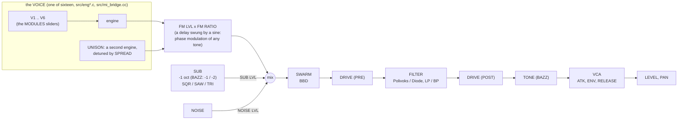

# The voice map: from LXRXXL BAZZLINE to LXRXXL ZYNTH

LXRXXL ZYNTH keeps LXRXXL BAZZLINE's voice and puts one of sixteen voice engines where BAZZLINE's oscillator was. The
code of the M-VAVE FM-1 firmwares (Felucca, Sloop, Baud Girl: GPL-3, which can't be combined with the LXR02 license)
and of the Dirtywave M8 (closed) is **not** used: they only inspired the choice of voices.

## 1. One track's voice

Everything after the engine is LXRXXL BAZZLINE's (`src/voice.c`): the envelopes, accent and sweep, slide, the pitch
envelope and the modulator. The modulator's WAVE destination moves the voice's main slider (`ENG_DEFS[].timbre`).

## 2. The sixteen voices

| Voice | Where from | How it works |
|---|---|---|
| ANALOG | written here | two polyBLEP oscillators (saw to square, pulse width), interval and detune, or hard sync at 2x oversampling |
| TRIO | written here | three polyBLEP oscillators at their own intervals, a detune spread |
| FM6 | written here; the DX7's 32 algorithms from music-synthesizer-for-android (Apache 2.0) | six sine operators on msfa's bus model (op 6 .. op 1, two buses, feedback in and out), 16 ratio sets, a modulator envelope (BRIGHT) |
| FM4 | written here | four operators on 12 algorithms, op 4's feedback, the modulators' envelope |
| PHASE | written here | Casio CZ style phase distortion of a cosine (eight waves, three of them windowed resonances), 2x oversampled, a DCW envelope, a detuned second line |
| WAVE | Mutable Instruments Plaits (MIT) | Plaits' wavetable engine (integrated waves, differentiated: no aliasing), then a warp written here (fold, shape, crush, ring) and a scan envelope |
| CHIP | written here | pulses, the NES's 4-bit triangle, a stepped saw, 15-bit LFSR noise; bits, sample-and-hold rate, chord arpeggio, pitch sweep |
| MACRO | Mutable Instruments Braids (MIT) | Braids' macro oscillator (44 shapes), run at 88.2 kHz and brought to 44.1 kHz by a half-band filter, pitched for its 96 kHz tables; timbre and color envelopes written here |
| WHEEL | written here | nine sine tonewheels (foldback above 5.9 kHz), percussion on the 2nd or 3rd harmonic, key click, a rotary speaker (horn: Doppler and loudness; drum: loudness, each rotor with its own inertia) |
| VOICE | written here | a band-limited glottal pulse with breath through three formant band-passes (A E I O U), delayed vibrato |
| PHYS | Mutable Instruments Plaits (MIT) | Plaits' string voice (Karplus-Strong with dispersion and a curved bridge) and modal voice (resonators), with Plaits' limiter |
| GRAIN | written here | up to 20 Hann-windowed grains reading 16 single-cycle waves (three band limits by pitch), spray, pitch spread |
| NOISE | written here | white, pink (Paul Kellet's filter), crackle (a chaotic map), digital (LFSR), dust; tilt; resonators on the note and its 2nd and 3rd harmonics; bit and rate reduction |
| LXR TONE | the LXR's tables (LXR02Open) | the LXR drum voice's oscillator and FM modulator on the LXR's band-limited tables, an FM envelope, decimation |
| LXR METAL | written here, after the LXR's hi-hat | six square oscillators at metallic ratios (808 hats, cymbal, bell, gong), FM, ring modulation, noise, a band-pass above the note |
| BAZZ | LXRXXL BAZZLINE | BAZZLINE's VCO / FM / WAVE oscillator on the LXR's tables, with an octave range, the sub's octave, drift and its tone filter |

## 3. What came from LXRXXL BAZZLINE (unchanged)

The sequencer (`seq.c`), the front panel's logic (`ui.c`), the delay and the gate/duck (`fx.c`), the mixer, the
presets (`preset.c`), the state chunk (`store.c`) and the Force integration (`engine.c`, the VST2 wrapper). The
randomizers (`random.c`) are LXRXXL's, for these tracks.
